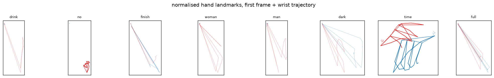
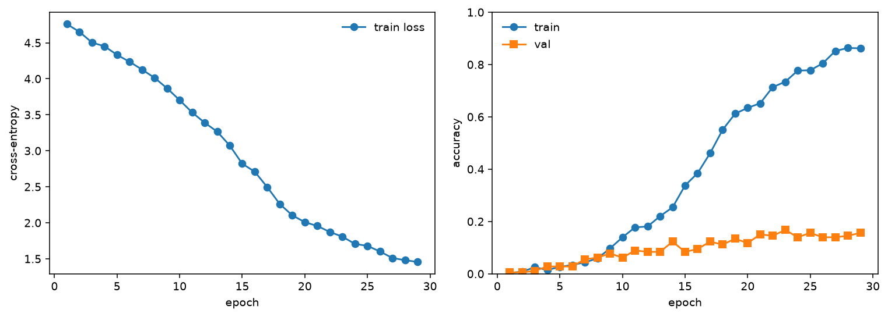
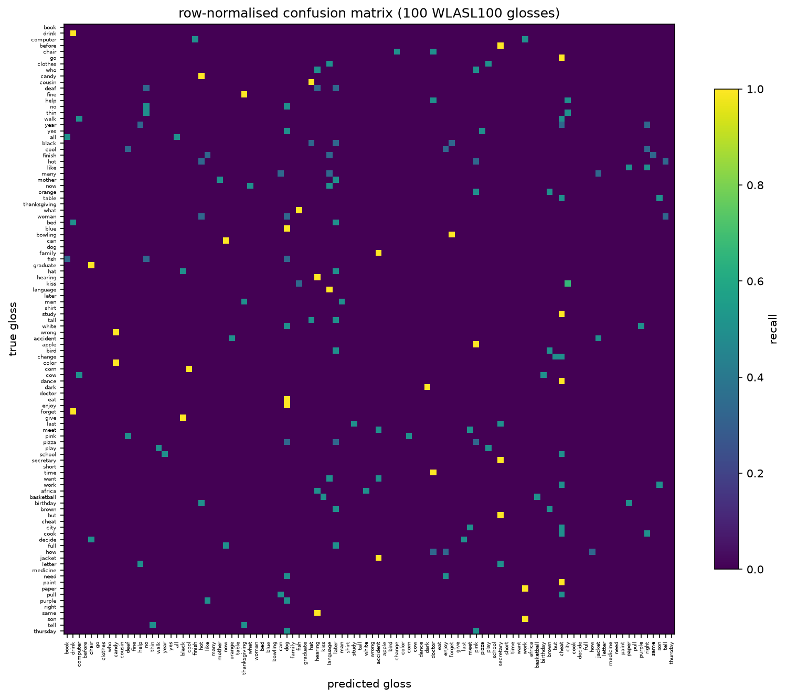
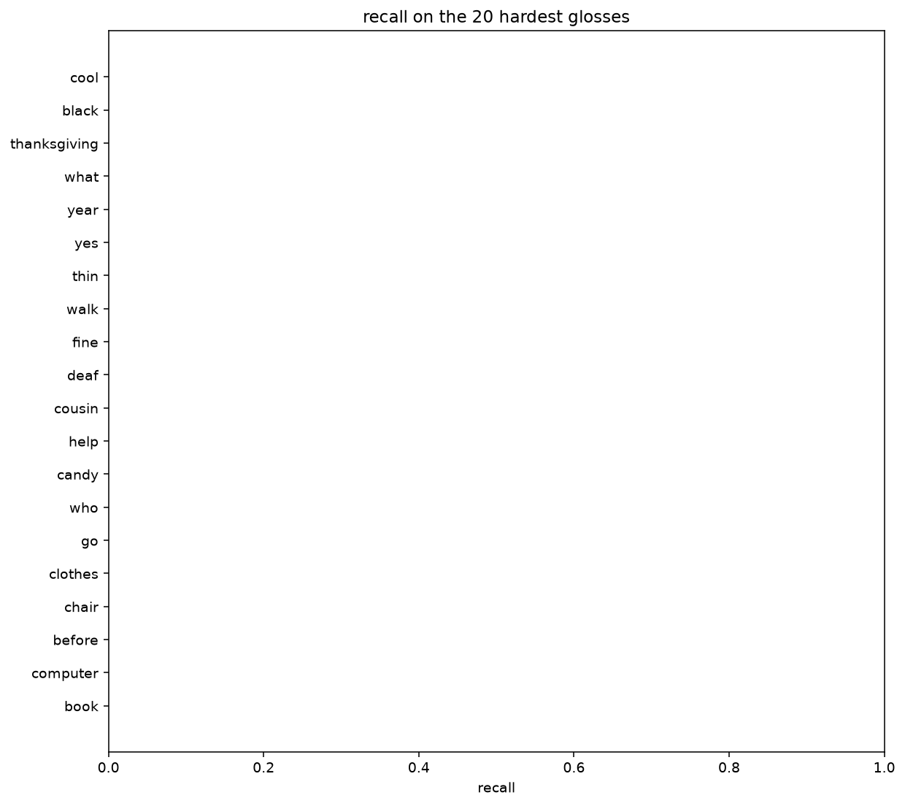

# Sign Language Recognition (WLASL100)

Isolated American Sign Language word recognition on the **WLASL100** benchmark:
the 100 most frequent glosses of WLASL v0.3, with the published train/val/test
splits and a biGRU over MediaPipe Holistic landmarks.

Pipeline: download every WLASL100 video -> extract pose and hand landmarks with
MediaPipe Holistic -> normalise to a fixed-length sequence -> train a
bidirectional GRU -> evaluate top-1/top-5 against simple baselines.

## Dataset

| item | value |
| --- | --- |
| source | [WLASL v0.3](https://github.com/dxli94/WLASL) (`WLASL_v0.3.json`) |
| classes | 100 glosses |
| instances | 2038 |
| splits | 681 train / 179 val / 162 test (official, by signer) |
| features | 32 frames x 75 landmarks (33 pose + 21 left hand + 21 right hand) x 3 coords |

**Reality check on availability:** WLASL videos live on 13 different hosts.
Auditing them from this machine (see `notes.md`), 783 instances sit behind bot
walls or dead URLs: signingsavvy/aslpro/handspeak refuse non-browser TLS
fingerprints, and 233 more YouTube clips failed with the `android` player
client. The pipeline ends up with **1022 usable instances across all 100
glosses**, and every number in `results/` is computed on those.

## Quickstart

```bash
.venv/Scripts/python.exe -m pip install -e .          # torch CPU wheel etc.
.venv/Scripts/python.exe -m sign_language.download     # videos + manifest
.venv/Scripts/python.exe -m sign_language.extract      # landmark cache (npz)
.venv/Scripts/python.exe -m sign_language.train        # biGRU + metrics + checkpoint
.venv/Scripts/python.exe -m sign_language.visualize    # figures
.venv/Scripts/python.exe -m sign_language.results_table
```

## Layout

```
src/sign_language/
  config.py         constants, paths and hyperparameters
  metadata.py       WLASL_v0.3.json reading, the 100-gloss class index
  download.py       resumable video download with a host audit + manifest
  extract.py        MediaPipe Holistic landmarks -> normalised (32, 75, 3) npz
  augment.py        mirror/rotate/scale/translate, applied in the xy plane
  dataset.py        splits, class weights, dataloaders
  model.py          SignGRU: proj + 2-layer biGRU + linear head
  baseline.py       nearest-mean and per-frame RandomForest baselines
  train.py          training loop, early stopping, checkpointing
  evaluate.py       top-1/top-5, macro F1, per-class table, confusion matrix
  visualize.py      training curves, confusion matrix, hardest-gloss recall, samples
  results_table.py  results_table.md / .csv and per-gloss recall csv
```

## Design decisions

- **Landmarks, not pixels.** Sign vocabulary is carried by hand shape and
  motion. 225 numbers per frame keep the model small and the training CPU-only.
- **Normalisation** (shoulder-centre, shoulder-width scale, 32-frame
  resampling) is done at extraction time, so the model sees a canonical pose.
- **Mirror augmentation swaps the left/right hand landmark blocks** - without
  that swap a mirrored sign is a different, wrong label.
- **Class-weighted cross-entropy and label smoothing** fight the 8-30 samples
  per class imbalance.

## Results

`results/results_table.md` is the current table; `results/sign_metrics.json`
and `results/figures/` hold the detailed numbers and plots.

Headline (test split, 162 instances over 100 glosses, chance = 0.01 top-1):

| model | top-1 | macro F1 | top-5 |
| --- | --- | --- | --- |
| SignGRU (biGRU, 2x256) | 0.1111 | 0.0822 | 0.2963 |
| per-frame RandomForest (200 trees, mean vote) | 0.1728 | 0.1327 | 0.3580 |
| nearest-mean (cosine, temporal mean) | 0.0370 | 0.0188 | 0.1914 |

### Figures

| | |
| --- | --- |
|  |  |
|  |  |

WLASL100 is a small dataset: expect top-1 well under 1.0 - published WLASL100
numbers with much heavier models sit around 0.4-0.8 top-1, so treat anything
above the baselines as real signal.

## Tests

```bash
.venv/Scripts/python.exe -m pytest -q
```

Unit tests use synthetic landmark caches (tmp dir + monkeypatched metadata),
so CI needs no dataset download.
